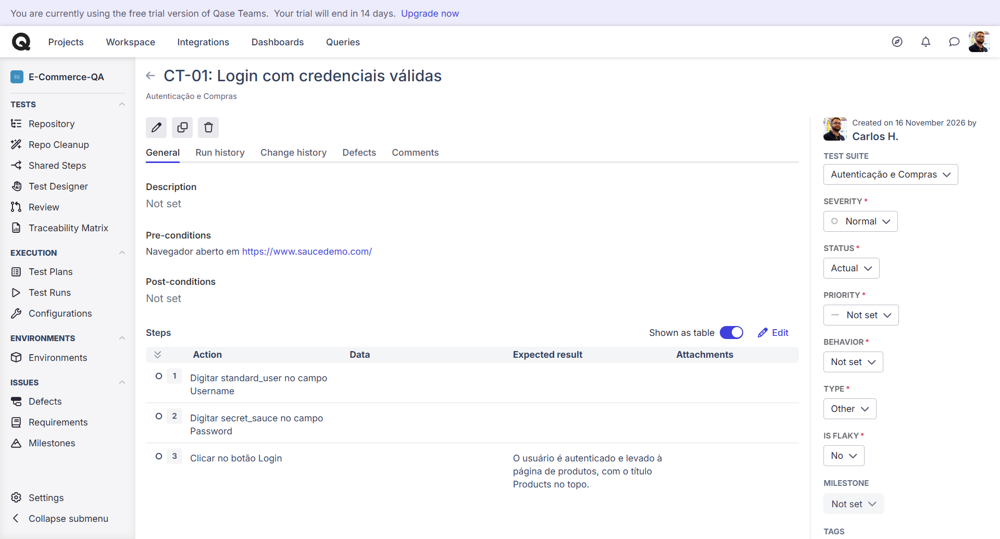
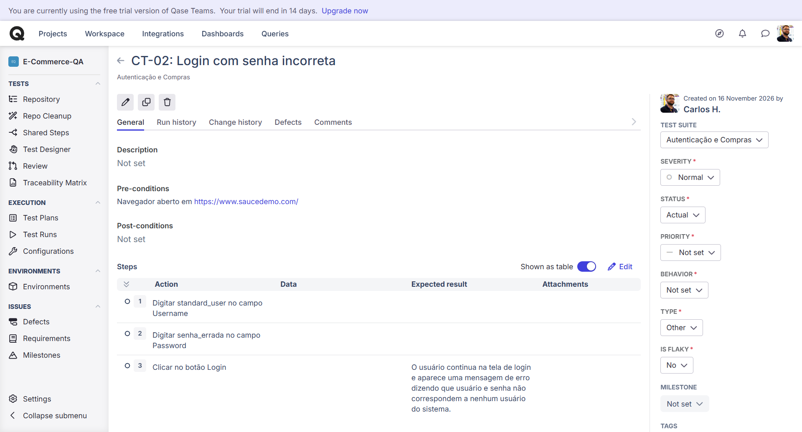
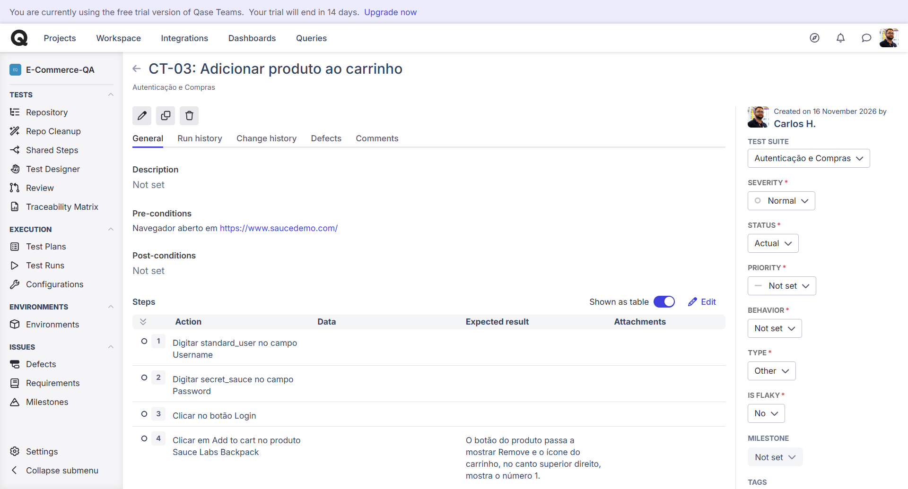
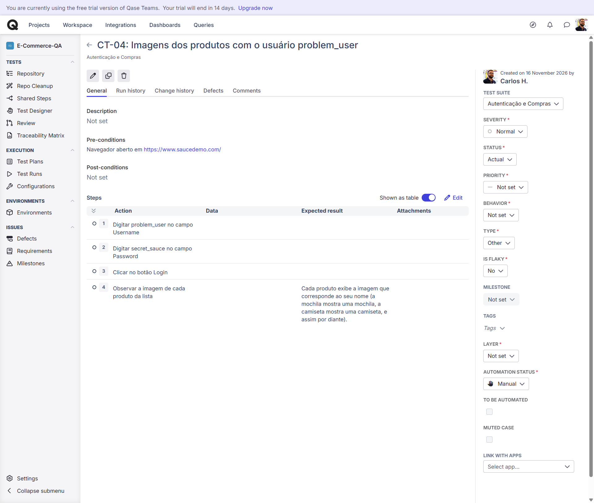
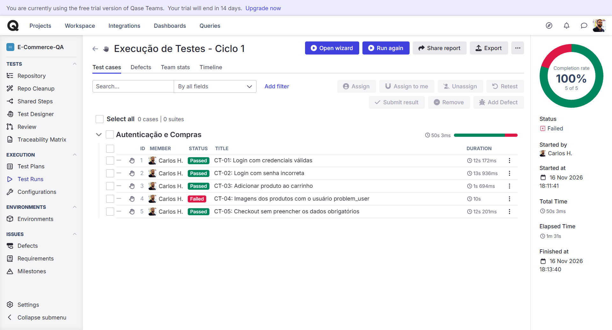
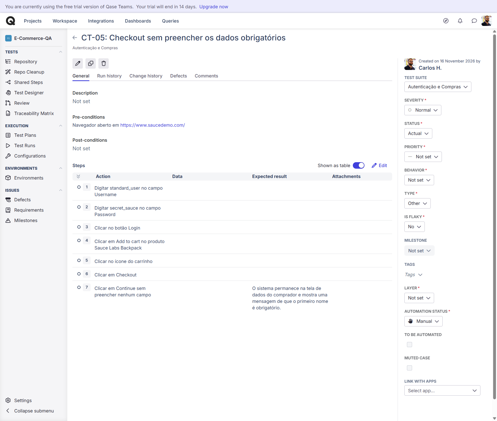

# Atividade: Primeiro Teste de Software

**Estudantes:** Carlos Henrique Alves e Felipe Gomes Rosa
**Curso e período:** Bacharelado em Sistemas de Informação, 8º período
**Disciplina:** Teste de Software

## Sistema testado
SauceDemo (https://www.saucedemo.com/)

## Classificação do teste realizado
- **Nível: sistema.** A loja foi testada inteira, pelo navegador, como um cliente a usaria.
- **Objetivo: funcional.** Os casos verificam se a loja faz o que deveria, como autenticar e adicionar ao carrinho.
- **Visão do código: caixa-preta.** Só observamos telas e resultados, sem acesso ao código.
- **Execução: dinâmico.** O sistema foi executado de verdade durante os testes.
- **Modo: manual.** Cada passo foi executado e conferido com o resultado esperado, um a um.
- **Motivo: teste novo.** Foi a primeira execução desses casos; repetidos após uma mudança, virariam teste de regressão.

## Casos de teste

## Execução

A execução "Execução de Testes - Ciclo 1" foi concluída com 5 casos: os 4 casos do guia, com 3 aprovados e 1 reprovado, e o caso opcional CT-05, aprovado.

| Caso | Resultado | Evidência |
|---|---|---|
| CT-01: Login com credenciais válidas | Passed | [captura](evidencias/ct-01-evidencia.png) |
| CT-02: Login com senha incorreta | Passed | [captura](evidencias/ct-02-evidencia.png) |
| CT-03: Adicionar produto ao carrinho | Passed | [captura](evidencias/ct-03-evidencia.png) |
| CT-04: Imagens dos produtos com problem_user | Failed | [captura](evidencias/ct-04-evidencia.png) |
| CT-05: Checkout sem preencher os dados obrigatórios (opcional) | Passed | [captura](evidencias/ct-05-evidencia.png) |

## Defeito encontrado
https://github.com/kralluz/relatorio-de-bugs-lab/issues/1

## Indo além: campos obrigatórios no checkout
**CT-05: Checkout sem preencher os dados (teste negativo).**
- Pré-condição: navegador aberto em https://www.saucedemo.com/
- Passos: (1) digitar `standard_user` no campo Username; (2) digitar `secret_sauce` no campo Password; (3) clicar em Login; (4) clicar em Add to cart no produto Sauce Labs Backpack; (5) clicar no carrinho; (6) clicar em Checkout; (7) clicar em Continue sem preencher nenhum campo.
- Resultado esperado: o sistema permanece na tela de dados do comprador e mostra uma mensagem de que o primeiro nome é obrigatório.
- Resultado obtido: a tela continua em "Checkout: Your Information" com a mensagem "Error: First Name is required".
- Veredito: Passed. [captura](evidencias/ct-05-evidencia.png)

## Respostas às perguntas para refletir
1. Porque o resultado esperado deve vir da lógica do sistema, e não do que a tela mostra. Se olharmos primeiro o que o sistema faz, tendemos a aceitar o comportamento como correto. Foi o que protegeu o CT-04: escrevemos que cada produto deveria ter sua própria imagem antes de ver as imagens repetidas.
2. O caso de teste é o roteiro que diz o que verificar e qual resultado esperar, e pode ser executado várias vezes. A issue é o relatório de um problema concreto, escrito para quem vai corrigi-lo, com ambiente, passos, evidência, severidade e prioridade. Precisamos dos dois porque um mostra como o defeito foi encontrado e o outro garante que ele seja entendido e corrigido; a rastreabilidade liga um ao outro.
3. Não. Os quatro casos cobrem só uma pequena parte da loja, e testar mostra que existem defeitos, mas não prova que eles não existem. Outras telas, outros usuários de teste, como `locked_out_user` e `error_user`, e outros dados de entrada ainda não foram verificados.
4. Testaria o fluxo completo de compra até a confirmação do pedido, incluindo os cálculos de subtotal, impostos e total. Depois, a validação de todos os campos do checkout, a ordenação dos produtos, a remoção de itens do carrinho e o comportamento dos outros usuários de teste. Também começaria a automatizar os casos que já existem, para repeti-los como testes de regressão.
5. A resposta da pergunta 5 está na seção "Classificação do teste realizado".
6. Não é teste unitário porque não tivemos acesso ao código nem testamos uma função isolada: testamos a loja inteira, pela interface. Não é teste de carga porque havia um único usuário fazendo uma ação por vez, sem medir o comportamento do sistema com muitos acessos simultâneos.
